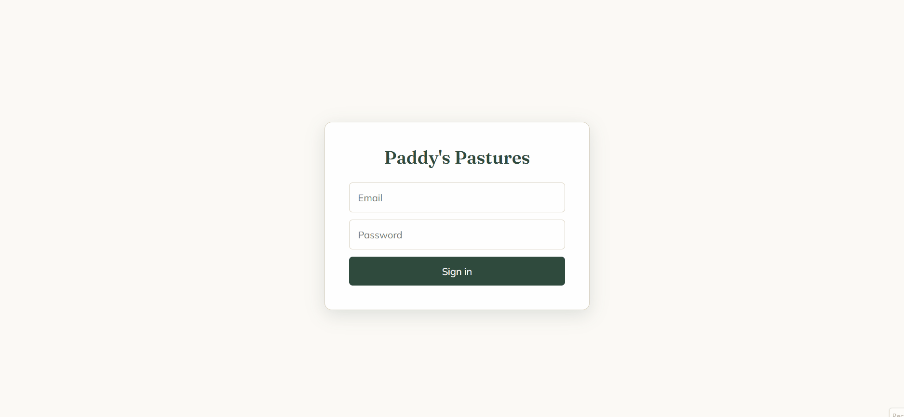

# Paddy's Pastures 🐴

A full-stack horse boarding management application built for a working horse barn to replace manual processes for horse care, boarder onboarding, and barn–owner communication.

**Live app:** https://app.paddyspastures.com
**Status:** In production, actively used by a Florida horse boarding facility

---

## Overview

Paddy's Pastures is a role-based web application that gives a horse barn a single system to manage boarders, horse profiles, daily care tracking, and communication. It was built for a real client — a small barn where the owner and manager needed something genuinely simple to use, reliable, and secure.

The app supports three types of users, each with distinct permissions enforced at the database level:

- **Admins** (barn owner/manager) — full control over accounts, horse setup, and barn operations
- **Staff** — daily care tracking and communication with boarders
- **Boarders** (horse owners) — self-onboarding, managing their own horse's profile, and messaging the barn

---

## Key Features

- **Three-role permission system** enforced with PostgreSQL Row Level Security and database triggers
- **Admin-managed account creation** — no public sign-up; the barn creates accounts, and new users complete a guided first-login setup (set password, add contact info)
- **Boarder self-onboarding** — boarders create and complete their own horse profiles, which then lock for editing and hand off to the barn
- **Two-stage horse profiles** — boarders provide owner/horse details; admins fill barn-managed fields (stall, feeding, turnout) via a "new boarded horses" queue
- **Real-time messaging** — boarder-to-barn conversations with a shared staff inbox, powered by Supabase Realtime
- **Daily treatment checklist** — staff track daily care tasks per horse (done / N/A), with dated history and a "notify owner" email
- **File uploads** — horse photos (public) and medical records (private, access-controlled via signed URLs) through Supabase Storage
- **Printable horse info sheets** — clean, print-optimized per-horse care sheets for barn staff
- **Email notifications** — transactional email through Resend from the barn's own verified domain (e.g. the barn is emailed when a boarder submits a new horse)
- **SMS notifications with no-login replies** — when a boarder messages the barn, opted-in admins get a text with a private reply link; tapping it opens the conversation and lets them answer without an account login, built for a barn owner who prefers texting to apps
- **Carrier-compliant SMS consent** — registered A2P 10DLC brand and campaign, web opt-in with versioned terms, an opt-in confirmation text, and STOP replies recorded back into the database automatically

---

## Tech Stack

**Frontend**
- React (Vite)
- React Router

**Backend / Infrastructure**
- Supabase — PostgreSQL, Auth, Row Level Security, Edge Functions (Deno/TypeScript), Storage, Realtime, pg_net (database-triggered webhooks), Vault (secrets the database needs)
- Netlify — hosting & continuous deployment, custom domain with SPA routing, static public pages
- Resend — transactional email
- Twilio — SMS through a Messaging Service on a registered A2P 10DLC campaign, with Advanced Opt-Out

**Tooling**
- Supabase CLI for database migrations
- GitHub / GitHub Desktop for version control

---

## Architecture Highlights

These are the decisions I'm most proud of and that shaped the project:

### Security enforced at the database, not the UI

Permissions aren't just hidden buttons in the frontend — they're enforced in PostgreSQL itself. Row Level Security policies control which rows each role can read and write, and `SECURITY DEFINER` triggers guard sensitive operations (e.g. a boarder cannot change their own role or edit barn-managed fields, and a completed horse profile is locked at the database level). Even a hand-crafted request bypassing the UI is refused by the database.

### Incremental, validation-first delivery

The app evolved deliberately: a single-file HTML prototype → a Supabase-backed single-file app → a full Vite/React production application. Each stage validated the core idea with the client before adding infrastructure complexity, avoiding over-engineering ahead of confirmed needs.

### Division-of-labor data model

The two-stage horse profile (boarders provide their information; admins provide barn-managed fields) mirrors how the barn actually operates, rather than forcing one person to enter everything.

### Server-side operations via Edge Functions

Privileged actions — admin account creation, sending email/SMS — run in Supabase Edge Functions where secrets stay server-side and are never exposed to the browser.

### Notifications driven by the database, not the UI

Notifications fire from database triggers rather than from React code, so they
happen no matter which screen (or future screen) causes the change. An
`AFTER INSERT`/`UPDATE` trigger queues an HTTP call with `pg_net`; the call is
only sent after the transaction commits, so a rolled-back change never sends a
text or email, and a slow provider never makes the user wait. The Edge
Function on the other end checks a shared secret that the database reads from
Supabase Vault, so the secret never appears in this public repo.

All outbound SMS goes through one helper (`supabase/functions/_shared/sms.ts`)
that re-checks consent from the database, adds the required business prefix
and opt-out language, sends, and writes an audit row. Its argument types make
it a compile-time error to send the opt-in confirmation with custom wording or
a notification without a message.

### Replying by link without a login

A text can't carry a session, so each SMS includes a single-purpose reply
link instead. The token is 32 random bytes; only its SHA-256 hash is stored,
so a leaked database or backup contains no working links. Each token is scoped
to one recipient and one conversation and expires after 72 hours. The public
`/r/:token` page talks to the database only through two `SECURITY DEFINER`
functions that validate the token before reading the thread or posting a
reply — the token tables themselves have row-level security on with no
policies, and all API privileges revoked.

### Verifying inbound webhooks

Twilio calls a public endpoint when someone texts the barn's number. Rather
than trusting the request, the Edge Function recomputes Twilio's HMAC-SHA1
request signature (over the exact public URL plus the sorted form fields) and
compares it in constant time before reading anything in the body. A forged or
altered request is rejected with a 403.

### Consent that can't drift from its audit trail

SMS consent is stored as two timestamps — when the user opted in, and when
they opted out — along with the version of the terms they agreed to. The
boolean the app actually reads is a Postgres generated column derived from
those timestamps:

    receives_sms boolean generated always as (
      sms_opt_in_at is not null
      and (sms_opt_out_at is null or sms_opt_out_at < sms_opt_in_at)
    ) stored

Postgres rejects any attempt to write that column directly. There is no code
path, in the app or in a migration, that can flip someone's SMS status
without leaving a dated record of why. Carrier regulations require proof of
consent; this makes that proof a structural property of the schema rather
than something the application has to remember to maintain.

The rest of the consent lifecycle follows from that:

- **Opting in** on the web sets `sms_opt_in_at`; a trigger then sends the
  registered opt-in confirmation text.
- **Texting STOP** (or any registered opt-out keyword) reaches the verified
  inbound webhook, which sets `sms_opt_out_at` on every profile with that
  phone number — opt-out applies to a number, not an account.
- **A recorded STOP is system-only.** A trigger rejects any change to
  `sms_opt_out_at` from a signed-in user, admins included, so an opt-out
  can't be undone from the browser. Only the server (service role) can
  write it.

Live testing turned up one undocumented gap: Twilio's `OptOutType` webhook
field never arrived, so the function matches the registered opt-out keywords
itself — the same whole-message, case-insensitive rule Twilio applies.

---

## Project Structure

```
src/                      React app (one component per screen)
public/                   Static pages served as plain HTML: about, privacy, SMS terms
supabase/migrations/      Schema, RLS policies, triggers, and SQL functions — in order
supabase/functions/       Edge Functions (account creation, email, SMS in and out)
supabase/functions/_shared/  Single sources of truth: email, SMS, app URL
```

---

## Demo 



---

## Notes

Built as both a production application for a real client and a portfolio piece demonstrating full-stack development, database security, and end-to-end delivery.